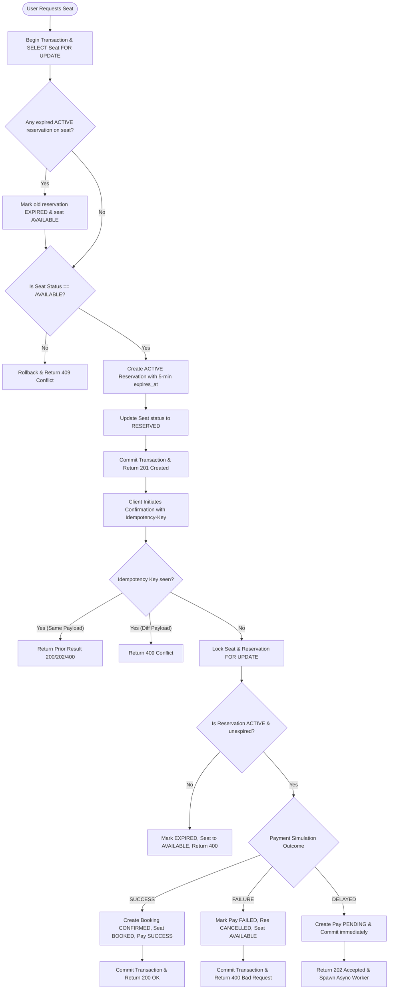

# Booking Workflow & State Machine

This document details the lifecycle of seat reservations, payment processing, booking confirmations, cancellations, and automatic expiration.

## 1. End-to-End Booking Lifecycle



## 2. Delayed Payment Workflow

```mermaid
flowchart TD
    StartDelayed[Client sends outcome = DELAYED] --> CreatePending[Persist Payment with PENDING status in DB]
    CreatePending --> CommitShort[Commit short transaction immediately<br/>Locks released!]
    CommitShort --> ClientResponse[Return HTTP 202 Accepted to Client]
    
    CommitShort --> AsyncSleep[Background Task sleeps for simulated_delay_seconds]
    AsyncSleep --> OpenTx[Start New Transaction]
    OpenTx --> LockEntities[SELECT Payment, Reservation, Seat FOR UPDATE]
    
    LockEntities --> VerifyRes{Is Reservation still ACTIVE<br/>& expires_at > now()?}
    
    VerifyRes -- No (Expired) --> MarkExpired[Set Payment EXPIRED<br/>Set Reservation EXPIRED<br/>Set Seat AVAILABLE]
    MarkExpired --> CommitExp[Commit Transaction]
    
    VerifyRes -- Yes (Valid) --> FinalizeSuccess[Set Payment SUCCESS<br/>Set Reservation CONFIRMED<br/>Create Booking CONFIRMED<br/>Set Seat BOOKED]
    FinalizeSuccess --> CommitDone[Commit Transaction]
```

## 3. Automatic & Lazy Expiration Workflow

```mermaid
flowchart TD
    subgraph Periodic Background Worker
        Tick[Every 10 seconds] --> QueryExpired[Find ACTIVE reservations WHERE expires_at <= NOW]
        QueryExpired --> Loop[For each expired reservation]
        Loop --> LockS[Lock Seat & Reservation FOR UPDATE]
        LockS --> CheckStillStale{Still ACTIVE & expired?}
        CheckStillStale -- Yes --> MarkExp[Set status EXPIRED]
        MarkExp --> CheckNoNewer{Any newer active hold?}
        CheckNoNewer -- None --> FreeSeat[Set Seat AVAILABLE]
        CheckNoNewer -- Exists --> KeepSeat[Keep Seat state]
        FreeSeat --> CommitWorker[Commit Transaction]
        KeepSeat --> CommitWorker
    end

    subgraph Lazy API Expiry
        ApiReq[Incoming API Call: GET /seats/available or POST /reservations] --> LazyCheck[Query seat for active expired reservations]
        LazyCheck --> ExpireStale[Expire stale hold on-demand before processing]
    end
```


