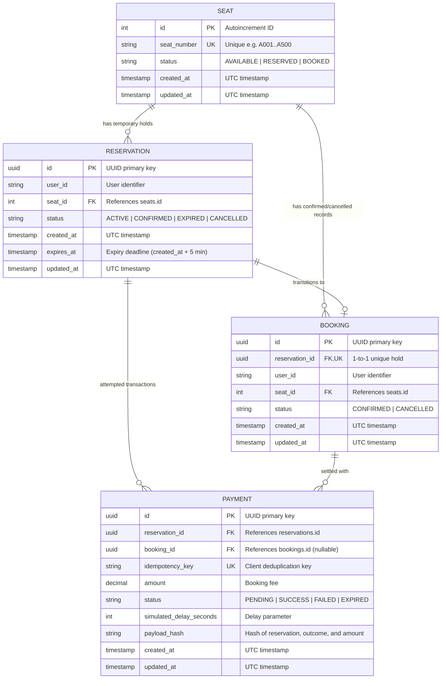

# Entity-Relationship Diagram (ERD) - The Last Seat

This document defines the relational database architecture and integrity constraints for **The Last Seat** high-concurrency ticket booking engine.

## Mermaid ER Diagram



## Key Database Constraints & Invariants

1. **Active Confirmed Booking Uniqueness (PostgreSQL Partial Unique Index)**:
   ```sql
   CREATE UNIQUE INDEX uq_seat_active_confirmed_booking
   ON bookings (seat_id)
   WHERE status = 'CONFIRMED';
   ```
   *Guarantees*: A seat can have multiple historical `CANCELLED` bookings, but at most **one** `CONFIRMED` booking can ever exist concurrently.

2. **Idempotency Key Uniqueness**:
   ```sql
   ALTER TABLE payments ADD CONSTRAINT uq_payments_idempotency_key UNIQUE (idempotency_key);
   ```
   *Guarantees*: Prevents double-charging or duplicate confirmation runs even under aggressive network retries.

3. **Foreign Key Integrity**:
   - `reservations.seat_id` -> `seats.id` (`ON DELETE CASCADE`)
   - `bookings.reservation_id` -> `reservations.id` (`ON DELETE RESTRICT`)
   - `bookings.seat_id` -> `seats.id` (`ON DELETE RESTRICT`)
   - `payments.booking_id` -> `bookings.id` (`ON DELETE SET NULL`)
   - `payments.reservation_id` -> `reservations.id` (`ON DELETE CASCADE`)
